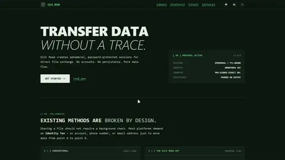

# SilkRoad

Ephemeral, anonymous file-sharing sessions with zero-persistence storage. Create a password-protected session with a TTL, share the session ID and key, and transfer files directly via pre-signed object storage URLs.

<p align="center">
  
</p>

## Features

- **Anonymous & Ephemeral**: No accounts or usernames — sessions track only active user count and auto-expire when TTL reaches zero or the last user leaves.
- **Direct Pre-Signed Transfers**: Files stream directly between the browser and S3-compatible storage (LocalStack locally, Cloudflare R2 in production).
- **Real-Time Sync**: STOMP over WebSocket (`/topic/session/{sessionId}`) updates user count and file lists live.

## Tech Stack

- **Frontend**: React 19, TypeScript, Tailwind CSS v4, Bun, `@stomp/stompjs`, `react-router-dom`
- **Backend**: Java 21, Spring Boot 3, Spring Data JPA (H2), Spring WebSocket (STOMP), JJWT, AWS SDK S3

## Local Development

### Prerequisites
- [Java 21+](https://adoptium.net/)
- [Bun](https://bun.sh/)
- [Docker](https://www.docker.com/) (for LocalStack S3 when `STORAGE_PROVIDER=local`)

### 1. Backend
```bash
cd backend
cp .env.example .env   # defaults to STORAGE_PROVIDER=local (HTTP :8080 + LocalStack S3)
./gradlew bootRun      # automatically starts LocalStack via docker compose
```
Switch `STORAGE_PROVIDER=prod` (and `SERVER_PORT=8443`, `SERVER_SSL_ENABLED=true`) in `backend/.env` to use Cloudflare R2 over HTTPS.

### 2. Frontend
```bash
cd frontend
bun install
bun run dev
```
Open `http://localhost:3000`.
